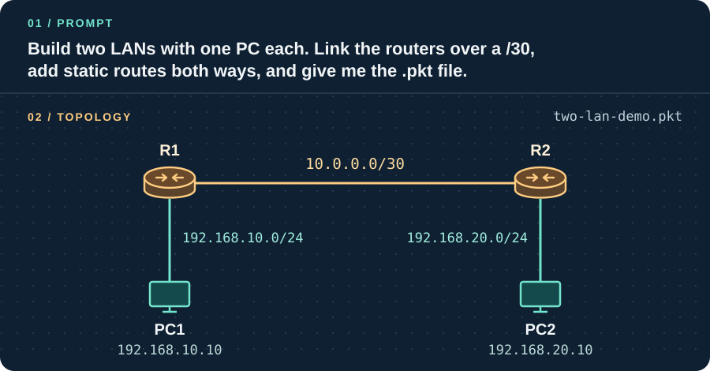

<div align="center">

# Give your AI a Packet Tracer skill.

**Describe your network. Get the `.pkt` file.**

[](https://github.com/evorajhonj/packet-tracer-skill/releases/latest)
[](https://github.com/evorajhonj/packet-tracer-skill/releases)
[](https://github.com/evorajhonj/packet-tracer-skill/stargazers)
[](https://github.com/evorajhonj/packet-tracer-skill/issues)

</div>

## See what you get

[](https://github.com/evorajhonj/packet-tracer-skill/releases/download/v1.0.0/two-lan-demo.pkt)

[**Download the pictured lab (.pkt)**](https://github.com/evorajhonj/packet-tracer-skill/releases/download/v1.0.0/two-lan-demo.pkt) and open it in Packet Tracer. No skill installation needed. To try the route, open **PC1 → Desktop → Command Prompt** and run `ping 192.168.20.10`.

## Use it with your AI

Paste this into an AI coding agent that can read and write files and run Python:

```text
Download https://github.com/evorajhonj/packet-tracer-skill/releases/download/v1.0.0/networking-v1.0.0.zip
and extract it into my workspace. Read networking/SKILL.md, then use its tools to
build the bundled copper-chain example. Save it as two-lan-demo.pkt and give me the file.
```

No agent-specific installer is required. If your agent can't download files, [download the skill ZIP](https://github.com/evorajhonj/packet-tracer-skill/releases/download/v1.0.0/networking-v1.0.0.zip) and extract it into the workspace yourself. A text-only chatbot without file or Python tools can help plan a lab, but can't run this builder.

<details>
<summary>Already using Codex? Install it as a reusable skill.</summary>

```text
Use $skill-installer to install https://github.com/evorajhonj/packet-tracer-skill/tree/v1.0.0/skills/networking
```

</details>

## What else can I ask?

- **Troubleshoot:** “PC1 reaches its gateway but not PC2. Check my attached lab for a missing return route and save any fix as a copy.”
- **Plan addresses:** “Split 192.168.40.0/24 for 61 staff interfaces, 29 lab interfaces and a two-address transit link. The counts include gateways.”

The builder creates Router-PT, Switch-PT and PC-PT copper labs from scratch. For other devices or WAN links, start with an existing lab. File checks inspect saved configuration; use Packet Tracer to test live traffic.

[Skill guide](skills/networking/SKILL.md) · [Topology plan format](skills/networking/references/fast-file.md) · [Troubleshooting](skills/networking/references/partial-connectivity.md) · [Third-party notices](skills/networking/scripts/THIRD_PARTY_LICENSE.txt)

Independent project. Not affiliated with Cisco.
